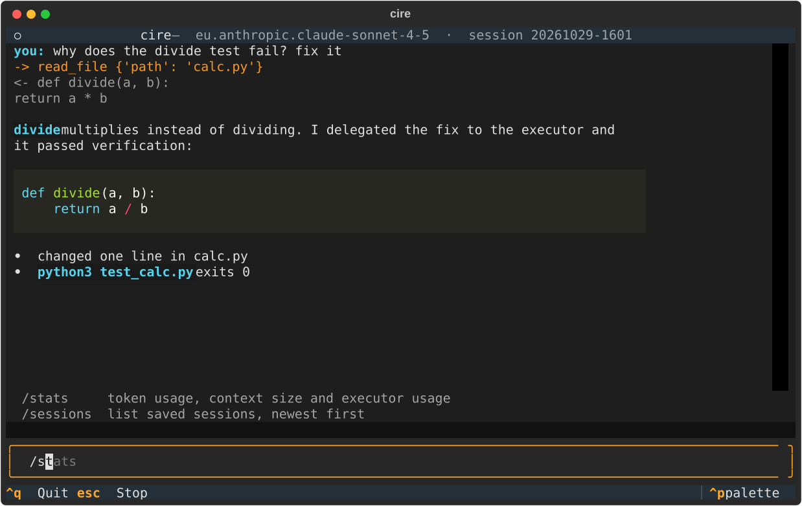

# cire-harness

[](https://m8ven.ai/mcp/fathdemr-cire-harness-spfj31?s=readme)

A multi-provider CLI agent harness. A strong **planner** model plans the work and verifies the results, while cheaper **executor** models do the heavy lifting. All context lives in a local SQLite store.



## Why

- **Lower cost:** expensive models only plan and verify, cheap models execute.
- **Multi-provider:** mix Anthropic and OpenAI models in a single run.
- **Local-first:** context is stored in SQLite on your machine, nothing is sent anywhere except to the model providers you configure.

## How it works

```
task -> planner (plan) -> executors (do the steps) -> planner (verify) -> result
                               |
                         local SQLite context
```

1. The planner breaks the task into steps.
2. Executor models run each step.
3. The planner verifies the output and requests fixes if needed.
4. Plans, steps and results are persisted in SQLite.

## Requirements

- Python 3.12 and [uv](https://docs.astral.sh/uv/)
- At least one model: an Anthropic or OpenAI API key, or a local [Ollama](https://ollama.com) install

## Installation

```bash
git clone https://github.com/fathdemr/cire-harness.git
cd cire-harness
uv sync
uv run cire --version
```

## Configuration

### API keys live in your shell, never in a file

cire reads provider keys from environment variables at runtime. There is no key field anywhere in its config, and nothing you type is written to disk except your chat history.

```bash
export ANTHROPIC_API_KEY=your_key            # anthropic:<model>
export OPENAI_API_KEY=your_key               # openai:<model>
export AWS_BEARER_TOKEN_BEDROCK=your_key     # bedrock:<model-id>, plus AWS_REGION
export AWS_REGION=eu-central-1
```

| Provider spec | Key variable | Notes |
| --- | --- | --- |
| `anthropic:claude-sonnet-4-5` | `ANTHROPIC_API_KEY` | Anthropic API, streaming |
| `openai:gpt-5` | `OPENAI_API_KEY` | OpenAI and any OpenAI-compatible endpoint |
| `bedrock:eu.anthropic.claude-sonnet-4-5-20250929-v1:0`, `bedrock:openai.gpt-oss-120b-1:0` | `AWS_BEARER_TOKEN_BEDROCK` + `AWS_REGION` | Any Bedrock model that supports the Converse API, with a [Bedrock API key](https://docs.aws.amazon.com/bedrock/latest/userguide/api-keys.html); non-streaming. Newer Claude models need the inference profile id (`eu.`, `us.` or `apac.` prefix), bare ids are rejected with HTTP 400 |
| `ollama:llama3.1` | none | local, uses the prompt-based tool fallback |

Each key is sent only to its own provider, over HTTPS, and never appears in logs or error messages. If a key is missing cire stops with a message naming the variable instead of sending an empty credential.

### Roles: planner and executor

cire can route work between two models. The model you chat with is the **planner**. When an **executor** role is set, the planner gets a `delegate` tool: it writes a short spec (goal, files, constraints, acceptance commands) and a cheaper model carries it out in a fresh context with file tools only. The harness then runs the acceptance commands itself, retries once with the failure output, and hands the planner a short report instead of the executor's whole history.

```bash
uv run cire role set planner bedrock:eu.anthropic.claude-sonnet-4-5-20250929-v1:0
uv run cire role set executor ollama:llama3.1
uv run cire role list
uv run cire chat          # planner from config, delegate available
uv run cire chat -p openai:gpt-5   # -p overrides the planner for this session
```

Executors cannot run shell commands. Their file writes still ask for confirmation, and verification is deterministic: a task passes only if every acceptance command exits 0 and no file outside the spec was touched. `/stats` shows planner and executor token usage separately.

### MCP servers

MCP servers are registered in `~/.cire/config.toml`. Use the CLI instead of editing the file:

```bash
# a local server started as a subprocess (everything after -- is the command)
uv run cire mcp add fs -- npx -y @modelcontextprotocol/server-filesystem .

# a server that needs a secret: name the variable, set its value in your shell
export GITHUB_TOKEN=ghp_...
uv run cire mcp add github --env GITHUB_TOKEN -- npx -y @modelcontextprotocol/server-github

# a remote Streamable HTTP server
uv run cire mcp add remote --url https://example.com/mcp

# skip the confirmation prompt for a server you trust
uv run cire mcp add fetch --trusted -- uvx mcp-server-fetch

uv run cire mcp list
uv run cire mcp remove remote
```

`--env` takes variable **names** only. The config stores the name, the value is read from your shell when the server starts, and cire refuses to save anything that looks like `NAME=value`. Subprocess servers start with a minimal environment, so a variable reaches a server only if you list it.

Tools from a server appear as `<server>_<tool>`, for example `fs_read_file`. Every MCP tool asks for confirmation before it runs unless the server was added with `--trusted`. Type `/tools` in the chat to see what is loaded.

The resulting file looks like this:

```toml
[mcp."github"]
command = "npx"
args = ["-y", "@modelcontextprotocol/server-github"]
env = ["GITHUB_TOKEN"]
```

## Usage

```bash
uv run cire chat                          # chat TUI, default provider ollama:llama3.1
uv run cire chat -p anthropic:claude-sonnet-4-5
uv run cire chat -s 20261029-140045      # resume a session
uv run cire run "list the python files" --yes
```

Slash commands in the chat: `/model`, `/sessions`, `/stats`, `/tools`, `/compact`. Press `Esc` to stop a running turn.

Large tool outputs are stored in SQLite and replaced in the prompt by a short preview and an id. The model fetches them back with the `recall` tool. When the context passes the token budget (`--budget`, default 8000) older messages are summarised automatically.

## Measuring cost

Every model call is recorded in the local SQLite store with its role, model, tokens and duration:

```bash
uv run cire stats                 # totals per role and model, with estimated USD
uv run cire stats -s <session>    # one chat session
```

Prices for common models are built in; add your own under `[prices."model-name"]` in the config (USD per million input and output tokens). Ollama counts as free.

## Benchmarks

`benchmarks/tasks/` holds five small repository tasks (fix a failing test, rename across files, implement a module from a spec, add a CLI flag, write tests). Each has a fixture repo and shell acceptance commands, so success is decided by the commands, not by a model.

```bash
uv run cire bench run --baseline bedrock:eu.anthropic.claude-sonnet-4-5-20250929-v1:0 \
  --planner bedrock:eu.anthropic.claude-sonnet-4-5-20250929-v1:0 \
  --executor ollama:llama3.1 --repeat 2
```

The run compares **single** (the baseline model alone, all tools) with **split** (planner + cheaper executor through `delegate`) and writes `docs/BENCHMARKS.md` plus raw JSON under `benchmarks/results/`. Full tables: [docs/BENCHMARKS.md](docs/BENCHMARKS.md).

Results from 2026-10-29, one run per task, five tasks, all passed in every configuration:

| Configuration | Avg cost / task | Avg seconds / task |
| --- | --- | --- |
| Claude Sonnet 4.5 alone | 0.057 USD | 21 |
| Claude Sonnet 4.5 planner + llama3.1 executor | 0.088 USD | 147 |
| gpt-oss-120b planner + llama3.1 executor | 0.004 USD | 42 |

What this says: on tasks this small the planner/executor split does not pay for itself with a strong planner. The planner still reads the repo, writes the spec, reads the report and re-checks the result, so its tokens exceed what it would spend just doing the edit, and a local 8B executor needs retries. The split wins when the planner is cheap (gpt-oss) or, presumably, when executor work dominates. Measure before you route.

## Project structure

```
src/cire_harness/
  cli.py        cire run / chat / mcp / role / stats / bench
  config.py     ~/.cire/config.toml
  providers/    Anthropic, OpenAI-compatible, Ollama, Bedrock, prompt-based tool fallback
  loop/         agent loop and tool execution
  orchestration/ task spec, executor loop, deterministic verification, delegate tool
  bench/        benchmark tasks runner and report
  telemetry.py  per-call usage records and price table
  tools/        read, write, edit, bash, grep
  mcp/          MCP client and tool adapter
  context/      SQLite store, masking, recall, compaction
  tui/          Textual chat app
```

## Security

- **No stored credentials.** Provider keys and MCP secrets are read from environment variables when needed. The config file holds variable names, never values. Missing keys fail fast with the variable name, and keys never appear in errors or logs.
- **Pinned endpoints.** Provider hosts are fixed in code; the Bedrock region from your environment is validated against the AWS region format before a URL is built from it.
- **Minimal environment for MCP servers.** A subprocess server sees only `PATH`, `HOME` and the variables you listed with `--env`.
- **Confirmation for risky tools.** Shell commands, file writes and all MCP tools prompt before running unless you opt out per server.
- **Sandboxed file tools.** Built-in file and grep tools refuse paths outside the working directory.
- **Local context.** Sessions and tool results stay in `~/.cire/cire.db` on your machine and go only to the provider you chose.
- Independent trust analysis: [M8ven report](https://m8ven.ai/mcp/fathdemr/cire-harness)

## Contributing

Issues and pull requests are welcome.

## License

TODO: license name (see `LICENSE`)
